# Vehicle-Aware Human Fallback: Braking-Only Recoverability, Evidence Boundaries, and VLA Trajectory Verification

**Repository:** `vehicle-aware-human-fallback`  
**Author:** Fengzhe Li  
**License:** MIT (Source Code)  
**Python Version:** Python >= 3.10 (tested on Python 3.14.5)

---

## Executive Overview

### 1. The Engineering Problem
In Level 3 (conditionally automated) driving, when an automated driving system encounters an operational design domain (ODD) limit or hazard, it issues a **Takeover Request (TOR)** to transfer control to the human driver. Evaluating whether a human handover is physically recoverable cannot rely on *Time-to-Collision (TTC)* or open-loop *Vision-Language-Action (VLA) trajectory error (ADE/FDE)* alone: a predicted trajectory may appear accurate in open-loop benchmarks while violating road-friction limits ($\mu g$), longitudinal state continuity during active braking, or leaving insufficient stopping distance once human reaction latency ($t_1 \in [1.15, 3.00]\text{ s}$) and brake actuation delays ($t_2, t_3$) are accounted for.

### 2. What I Built
This repository provides a two-part open-source safety-engineering and AI-verification codebase:
- **Core Recoverability & Identifiability Framework (`src/`, `research/`, `results/`):** A signal-processing audit of 513 conditionally automated takeover simulator trials (TU Delft D003), EPA coastdown road-load calibration, and a closed-form interval-bounded braking recoverability solver (**Phase R3B**) across 150 scenario–friction–policy slices (`P0`, `P1`, `P2`), governed by **42 frozen claims** ([`research/R5A_CLAIM_LEDGER.csv`](research/R5A_CLAIM_LEDGER.csv)).
- **VLA-Informed Handover Feasibility Extension & Interactive Demonstrator ([`extensions/vla_handover_feasibility/`](extensions/vla_handover_feasibility/)):** An end-to-end physical verification pipeline and interactive engineering demonstrator (`interactive_explorer.py`, `report_generator.py`) that runs genuine **AutoVLA** (`Qwen2.5-VL-3B-Instruct` + `2,048` physical `<action_k>` tokens) on 7 multi-view nuPlan/OpenScene driving scenes (`10` total saved rollouts including controlled command and signed-acceleration interventions), audits decoded SE(2) trajectories against 10 vehicle-dynamics constraints (`C1`–`C10`), couples step-by-step trajectory playback directly to an interactive **4-Phase R3B Human Takeover Feasibility Simulator**, enforces an **11-point cryptographic provenance auditor**, and generates a self-contained interactive English HTML/PDF dashboard.

### 3. Technologies Used
- **AI & Multimodal Inference:** PyTorch, Hugging Face `transformers` (`Qwen2.5-VL`, `bfloat16` `safetensors` with exact `825/825` `strict=True` state-dict bijection), `qwen-vl-utils`, AutoVLA physical action codebook (`2,048` tokens).
- **Scientific Computing & Verification:** Python 3.10+, NumPy, SciPy, Pandas, SymPy (symbolic monotonicity verification), Matplotlib.
- **Quality Assurance & Reproducibility:** Pytest (`21` VLA extension tests + `424` public-clone baseline tests), SHA-256 artifact & sensor-manifest auditing, Headless Chromium CDP visual QA, GitHub Actions CI.

### 4. What the System Demonstrates
- **Interactive R3B Human Takeover Feasibility Simulator & AutoVLA Trajectory Explorer ([`interactive_explorer.py`](extensions/vla_handover_feasibility/interactive_explorer.py)):**
  - **Capability 1 — Interactive AutoVLA Trajectory & Step-Aware Physics Explorer:** Scrubs or animates all `10` saved AutoVLA rollouts across the `7` real driving scenes (`t = 0.0 s` observed state + `10` discrete steps $k \in \{1..10\}$ at `0.5 s` resolution, plus optional `0.1 s` display interpolation clearly badged as interpolated), overlays logged human trajectories and controlled command/ablation counterparts in Bird's-Eye View (`+x` forward, `+y` left, $\pm 1.75\text{ m}$ R3B corridor), and inspects step-level `C1`–`C10` physical constraints while strictly separating `TIME_LOCAL_STEP` interval checks (`C2`–`C10`, marked `NOT_DEFINED_AT_T0` at $t = 0.0\text{ s}$) from `TRAJECTORY_WIDE` checks (`C1`).
  - **Capability 2 — Coupled & Standalone R3B Human Takeover Simulator:** Evaluates the exact validated 4-phase analytical R3B stopping equations (`stopping_distance_r3b_analytical`, `t_required`, `effective_braking_deceleration`) across policy branches `P0` (Hold Speed), `P1` (EPA Coastdown Drag), and `P2` (Supported Decel $a_{\text{sup}} \in [1.0, 3.0]\text{ m/s}^2$) with live controls for speed (`m/s` $\leftrightarrow$ `km/h`), obstacle source/distance $d_0$, takeover delay $\tau_{\text{req}} \in [0.0, 3.0]\text{ s}$, friction $\mu$ (`Dry 1.0`, `Wet 0.7`, `Rain 0.5`, `Snow 0.35`), and human/brake parameters ($t_1, t_2, t_3, a_{\max}, a_{\text{sup}}$). Explicitly separates **Layer 1 Observed Evidence**, **Layer 2 Assumed Counterfactual Inputs**, and **Layer 3 Derived Model Conclusions** using five non-safety presentation labels (`NECESSARY_CONDITION_SATISFIED`, `NECESSARY_CONDITION_VIOLATED`, `PARAMETER_SENSITIVE`, `NOT_APPLICABLE`, `INSUFFICIENT_EVIDENCE` — never `"SAFE"`).
- **Genuine VLA Trajectory Decoding & Physical Auditing:** Sub-meter highway tracking (`scene_01`: `ADE = 0.36 m`, `FDE = 0.76 m`) alongside automatic detection of wet-pavement lateral acceleration violations (`scene_02`: $|a_{\text{lat}}| = 2.27\text{ m/s}^2 > 2.00\text{ m/s}^2$ at $\mu = 0.5$, triggering `C7_LATERAL_ACCELERATION_LIMIT`).
- **Active-Braking Prompt Vulnerability (`scene_05`, `EXT-VLA-C03`):** In `scene_05_active_braking_deceleration`, the ego vehicle is actively braking ($a_{x,0} = -1.5525\text{ m/s}^2$, $v_0 = 4.3103\text{ m/s}$). Because AutoVLA's upstream prompt encodes acceleration as an unsigned scalar norm (`1.56 m/s^2`), the model reverses into strong positive acceleration (`+1.5442 m/s^2` at $t = 1.5\text{ s}$, `FDE = 12.90 m`), violating `C10_LONGITUDINAL_ACCEL_STATE_CONSISTENCY` (`3.10 m/s^2 > 2.50 m/s^2`) and eroding counterfactual R3B stopping margins as takeover is delayed.
- **Controlled Single-Variable Signed-Acceleration Ablation (`scene_05`, `EXT-VLA-C03`):** Holding the checkpoint, 12 camera frames, velocity, command, and greedy decoding identical while replacing `"1.56 m/s^2"` with signed `"-1.55 m/s^2"` ([`ablation_scene_05_signed_accel.json`](extensions/vla_handover_feasibility/artifacts/ablation_scene_05_signed_accel.json)) sustains deceleration and reduces `0.0–2.0 s` braking-phase ADE by **88.1%** (`1.2131 m` $\to$ `0.1448 m`; full `5.0 s` ADE `6.2543 m` $\to$ `2.4210 m`), while exposing single-scene out-of-distribution (OOD) token jitter at standstill ($t = 4.5\text{ s}$).
- **Methodological Auditing of Driving-Command Leakage (`EXT-VLA-C06`) & Controlled Command Sensitivity (`EXT-VLA-C07`):** Programmatically flags turning scenes (`scene_02` and `scene_06`, where `"turn left"` aligns with future ground-truth lateral displacement $y_{\text{GT}}(3.0\text{ s}) > 4.0\text{ m}$) and executes a controlled single-variable command intervention (`"turn left"` $\to$ `"keep forward"`, [`artifacts/command_sensitivity/`](extensions/vla_handover_feasibility/artifacts/command_sensitivity/)) holding all 12 camera frames and initial kinematics fixed. Replacing `"turn left"` with `"keep forward"` changes `10/10` tokens in `scene_02` ($\Delta y(5\text{ s}) = -6.75\text{ m}$, $-34.1\%$, doubling admissible 1D R3B corridor steps from `3/7` to `6/7`) and `8/10` tokens in `scene_06` (reducing Step 1 $|a_{\text{lat}}|$ by **61.8%** and $\Delta y(5\text{ s})$ by $-2.55\text{ m}$, $-33.6\%$), while visual intersection geometry still pulls the trajectory left later in the horizon. *(Critical Interpretation Rule: the logged left-turn trajectory is not a valid ground-truth target for `"keep forward"`, so ADE/FDE shifts measure command sensitivity rather than policy quality.)*
- **Scene 05 `C10` Numerical Robustness Audit (`EXT-VLA-C08`):** Audits the `scene_05` braking-to-acceleration reversal across **5 discrete derivative estimators** (`E1`–`E5`), **5 temporal windows** (`W1`–`W5`), and **3 illustrative diagnostic thresholds** (`2.0, 2.5, 3.0 m/s^2`, [`artifacts/c10_robustness/`](extensions/vla_handover_feasibility/artifacts/c10_robustness/)). The `C10` violation is **100% robust (`30/30` cells violated)** across all 5 estimators for windows $\ge 1.5\text{ s}$ at thresholds $\le 2.5\text{ m/s}^2$ (`peak |a_lon - a_x(0)| = 3.0967 m/s^2` on `E1/E2/E3`, `2.8516` on `E4`, `2.6825` on `E5`; 9 consecutive positive-acceleration steps $t = 1.0..5.0\text{ s}$), while sensitive to early windows ($t \le 1.0\text{ s}$) and to multi-step smoothing (`E4/E5`) at the `3.0 m/s^2` threshold (`45/75` total cells violated; `0/75` active-motion violations on the signed OOD ablation).

### 5. One-Command Offline Demo (`< 1 second` after install, no GPU or restricted data required)

```bash
git clone https://github.com/fengzhe-li/vehicle-aware-human-fallback.git
cd vehicle-aware-human-fallback
python3 -m venv .venv && source .venv/bin/activate
pip install --upgrade pip && pip install -r requirements.txt

# Recompute all 7 VLA trajectory checks, R3B margins, provenance audit, and open the HTML dashboard:
python -m extensions.vla_handover_feasibility.demo
```
*(In headless or CI environments, pass `--no-open`: `python -m extensions.vla_handover_feasibility.demo --no-open`. The offline demo uses the 7 committed genuine AutoVLA prediction artifacts and `agent_vocab.pkl` without loading the 8.14 GB model checkpoint or restricted camera JPEGs.)*

### 6. End-to-End VLA Handover Verification Architecture

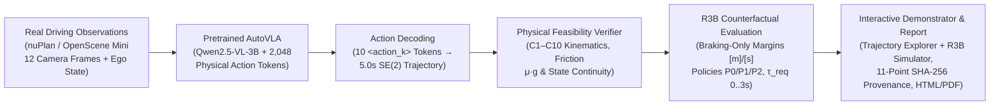

### 7. Interactive English Research Dashboard & Demonstrator Preview

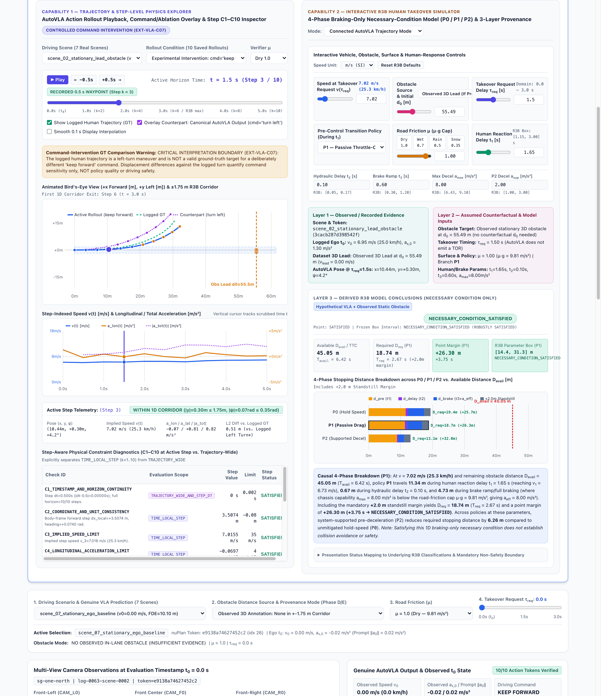
*Screenshot 07: Interactive Demonstrator Workspace showing Capability 1 (AutoVLA Trajectory & Step-Aware C1–C10 Physics Explorer on Scene 02 `keep forward` vs `turn left` at $t = 1.5\text{ s}$) coupled live to Capability 2 (4-Phase R3B Human Takeover Feasibility Simulator across `P0`/`P1`/`P2` with 3-Layer Provenance and non-safety status mapping).*

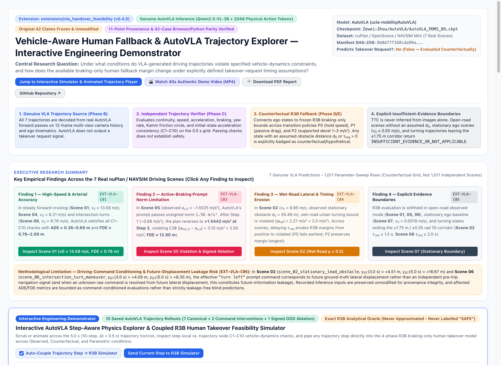
*Screenshot 01: Executive Research Summary (`EXT-VLA-C01`–`EXT-VLA-C08`), driving-command leakage disclosure banner (`EXT-VLA-C06`), interactive control bar, and Scene 01 overview.*

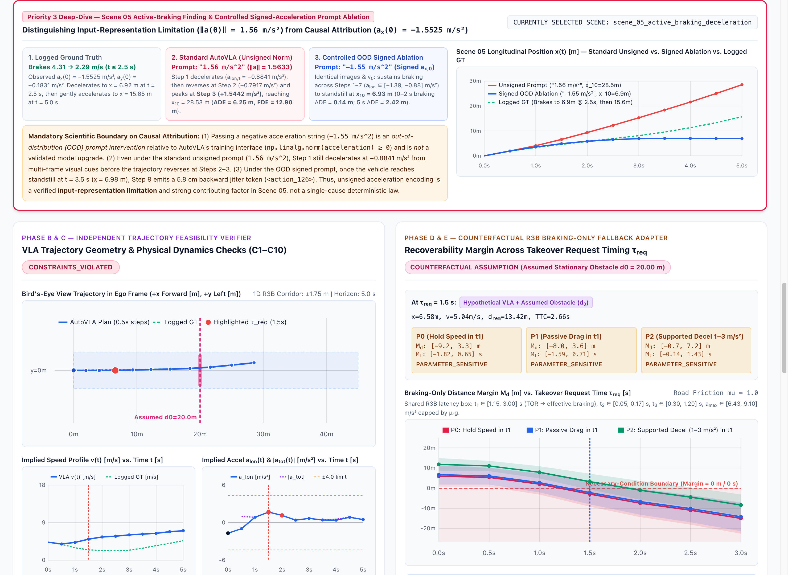
*Screenshot 02: Scene 05 `C10_LONGITUDINAL_ACCEL_STATE_CONSISTENCY` violation (`+1.5442 m/s^2` vs `-1.5525 m/s^2`) and single-variable signed-acceleration prompt ablation (`-1.55 m/s^2`) with OOD causal boundary notices.*

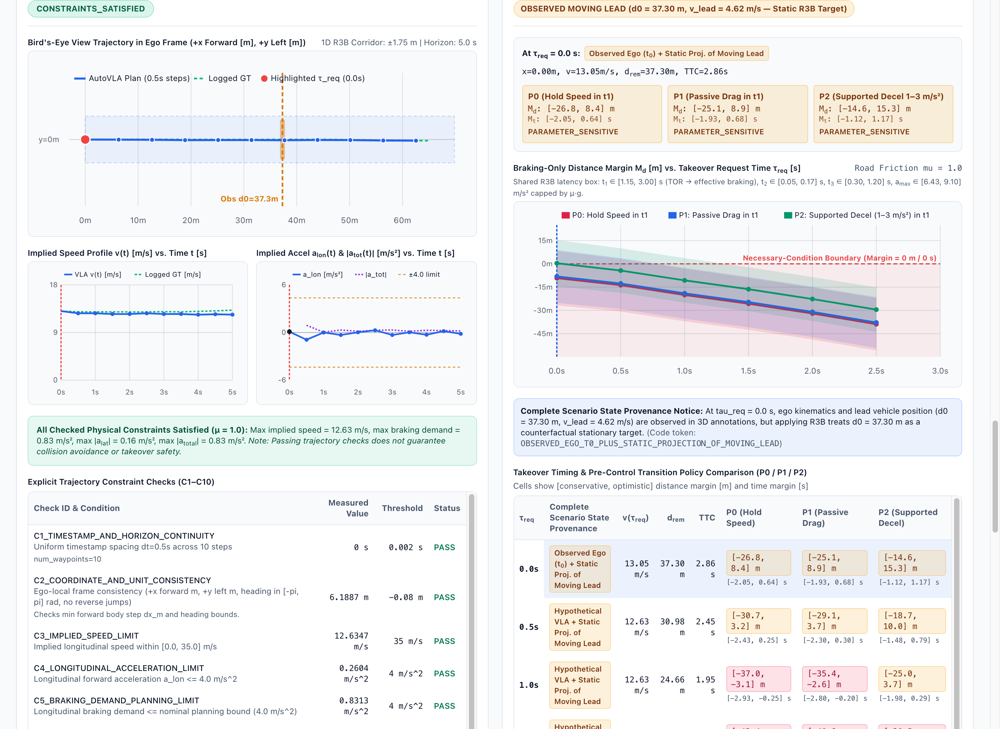
*Screenshot 03: Scene 03 R3B braking-only stopping distance (`[m]`) and time (`[s]`) margins across takeover request times $\tau_{\text{req}} \in [0.0, 3.0]\text{ s}$ and policies `P0`, `P1`, and `P2`.*

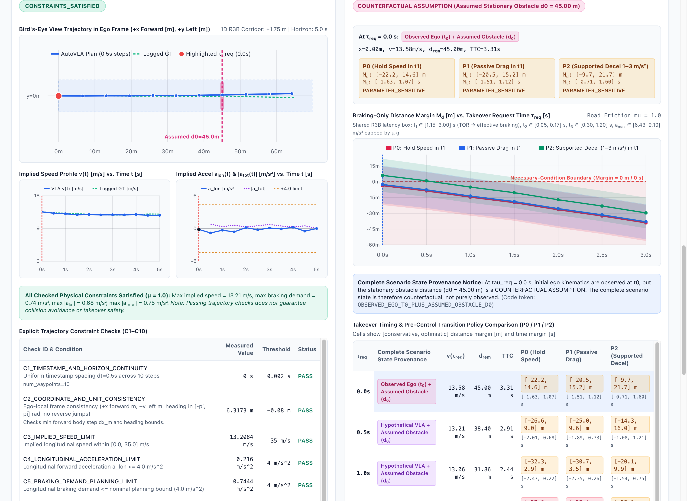
*Screenshot 04: Scene 01 counterfactual $d_0 = 45.00\text{ m}$ schedule explicitly badged as `Observed Ego (t0) + Assumed Obstacle (d0)` at $\tau_{\text{req}} = 0.0\text{ s}$ and `Hypothetical VLA + Assumed Obstacle (d0)` at $\tau_{\text{req}} > 0$.*

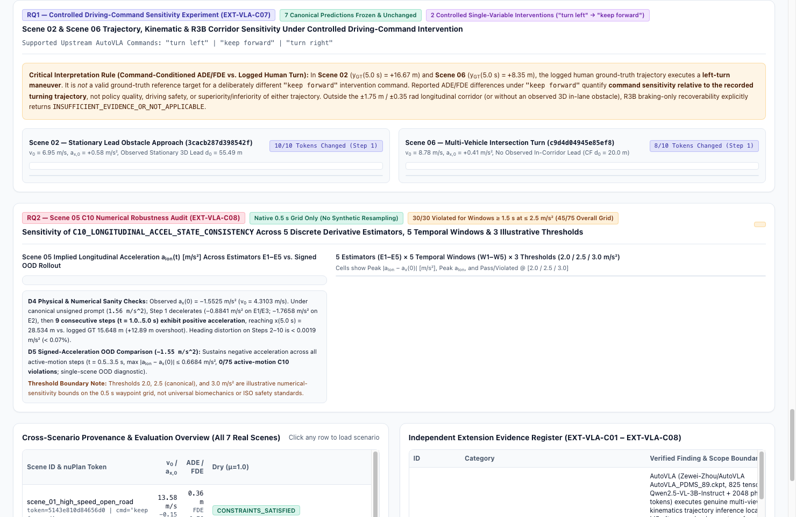
*Screenshot 05: RQ1 Controlled Driving-Command Sensitivity (`turn left` $\to$ `keep forward`, `EXT-VLA-C07`) on Scenes 02 and 06 with token-level divergence and R3B corridor admissibility impact.*

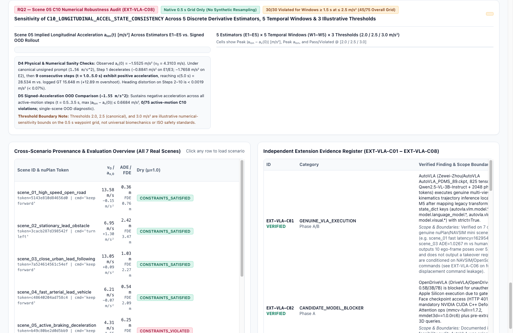
*Screenshot 06: RQ2 Scene 05 `C10` Numerical Robustness Audit (`EXT-VLA-C08`) across 5 discrete derivative estimators (`E1`–`E5`), 5 temporal windows, and 3 diagnostic thresholds.*

### 8. Audited 7-Scene VLA Summary & Epistemic Boundaries

Full technical documentation, step-wise kinematics, synthetic verifier stress fixtures (`SYNTHETIC_FIXTURE_ONLY`), and live vs. offline reproduction details are provided in [`extensions/vla_handover_feasibility/README.md`](extensions/vla_handover_feasibility/README.md):

| Scene ID | nuPlan Token | $v_0$ ($\text{m/s}$) | $a_{x,0}$ ($\text{m/s}^2$) | Prompt $\|a_0\|$ ($\text{m/s}^2$) | Command (Leakage Audit) | ADE / FDE ($\text{m}$) | Nominal ($\mu=1.0$) | Wet ($\mu=0.5$) | R3B $P_1$ ($\mu=1.0$) Handover Summary ($\tau_{\text{req}} = 0\text{ s} \to 2\text{ s}$) |
| :--- | :--- | :---: | :---: | :---: | :--- | :---: | :---: | :---: | :--- |
| `scene_01_high_speed_open_road` | `5143e810d84656d0` | `13.58` | `-0.15` | `0.19` | `keep forward` (Clean) | `0.36` / `0.76` | `SATISFIED` | `SATISFIED` | `INSUFFICIENT_EVIDENCE` (Observed); Counterfactual $d_0=45\text{ m}$ badged separately |
| `scene_02_stationary_lead_obstacle` | `3cacb287d398542f` | `6.95` | `+1.30` | `1.35` | `turn left` (**Leakage Flag**\*) | `2.42`\* / `3.47`\* | `SATISFIED` | **`VIOLATED` (`C7`)** | Observed ($d_0=55.5\text{ m}$): `ROBUSTLY_SATISFIED` $\to$ departs 1D corridor ($\ge 2.5\text{ s}$) |
| `scene_03_close_urban_lead_following` | `7a524614561c54ef` | `13.05` | `+0.09` | `0.10` | `keep forward` (Clean) | `1.03` / `2.27` | `SATISFIED` | `SATISFIED` | Observed ($d_0=37.3\text{ m}$): `PARAMETER_SENSITIVE` $\to$ `ROBUSTLY_UNSATISFIED` |
| `scene_04_fast_arterial_lead_vehicle` | `c48640204ad758c4` | `6.21` | `-0.07` | `0.07` | `keep forward` (Clean) | `0.54` / `2.09` | `SATISFIED` | `SATISFIED` | Observed ($d_0=68.0\text{ m}$): `ROBUSTLY_SATISFIED` across $\tau_{\text{req}} \in [0.0, 3.0]\text{ s}$ |
| `scene_05_active_braking_deceleration` | `b49c80be2d0d5bb9` | `4.31` | `-1.55` | `1.56` | `keep forward` (Clean) | `6.25` / `12.90` | **`VIOLATED` (`C10`)** | **`VIOLATED` (`C10`)** | `INSUFFICIENT_EVIDENCE` (Observed); CF ($d_0=20\text{ m}$): `ROBUSTLY_SATISFIED` $\to$ `UNIFORMLY_VIOLATED` |
| `scene_06_intersection_turn_maneuver` | `c9d4d04945e85ef8` | `8.78` | `-0.40` | `1.41` | `turn left` (**Leakage Flag**\*) | `0.66`\* / `1.88`\* | `SATISFIED` | `SATISFIED` | `INSUFFICIENT_EVIDENCE` (Turn scenario without in-lane corridor obstacle) |
| `scene_07_stationary_ego_baseline` | `e9138a74627452c2` | `0.00` | `-0.02` | `0.02` | `keep forward` (Clean) | `3.93` / `10.10` | `INSUFFICIENT_EVIDENCE` | `INSUFFICIENT_EVIDENCE` | `INSUFFICIENT_EVIDENCE` (Stationary baseline $v_0 \le 0.05\text{ m/s}$) |

- **\*Driving-Command Future-Displacement Leakage Disclosure (`EXT-VLA-C06`):** In `scene_02` ($y_{\text{GT}}(3.0\text{ s}) = +4.5128\text{ m}$) and `scene_06` ($y_{\text{GT}}(3.0\text{ s}) = +4.0889\text{ m}$), conditioning on `"turn left"` (or resolving an unknown raw approach command from future lateral displacement) conveys future maneuver direction. Their open-loop `ADE`/`FDE` values are **command-conditioned evaluations**, not leakage-free blind predictions.
- **No Native VLA Takeover-Request Signal (`EXT-VLA-C01`):** AutoVLA predicts 10-step trajectories (`predicts_human_takeover_request = False`); all $\tau_{\text{req}} > 0$ evaluations represent counterfactual delays along hypothetical VLA states.

---

## Core Baseline Research Question

> Under what combinations of vehicle dynamics, human driver capability, handover policy, and scenario criticality does human fallback remain an effective and physically recoverable safety mechanism during time-critical automated-driving takeovers?

In Level 3 (conditionally automated) driving, when an automated driving system reaches its operational design domain (ODD) limit or detects an unmanageable hazard, it issues a Takeover Request (TOR) to transition control authority to the human driver. Conventional safety engineering often evaluates takeover safety primarily through *takeover lead time* (e.g., Time-to-Collision at TOR). This project investigates whether fallback recoverability is governed by joint physical interactions among:
1. **Vehicle braking capability and road friction** ($\mu$, $a_{\max}$, actuator delay, hydraulic pressure rise);
2. **Human response latency and action sequencing** ($t_{\text{button}}$, brake onset, steering onset);
3. **Control authority transition policies** (timing of automation authority withdrawal vs. effective human input); and
4. **Initial kinematic state and scenario criticality** ($v_0$, TTC, road stationing).

---

## What This Repository Contains

This repository contains the complete open-source scientific codebase, verification test suite, derived analytical datasets, claim ledger, and deterministic figure-generation pipelines for the project:

- **D003 Evidence and Observability Audit:** A complete signal-processing and control-channel audit of the TU Delft conditionally automated driving takeover simulator dataset (D003; Happee et al.), analyzing 513 trials across 57 participants.
- **Human Response Timing Analysis:** Empirical distributions of driver mode-switch button response times ($t_{\text{button}}$), repeated-exposure practice slopes, and carry-over sensitivity models across consecutive TOR exposures.
- **Vehicle and Automation Parameter Evidence:** Road-load deceleration models calibrated from official EPA certification test data, paired with physical braking limits (Coulomb friction caps $\mu g$, hydraulic actuation delay $t_2$, deceleration rise time $t_3$).
- **Deterministic Interval-Bounded Braking Model (Phase R3B):** An analytical, open-loop kinematic model calculating required stopping time $T_{\text{req}}$ and margin $\Delta T = \text{TTC} - T_{\text{req}}$ across parameter intervals, with closed-form coordinatewise-monotonicity guards.
- **P0/P1/P2 Counterfactual Transition Branches:** Three distinct handover authority policies modeling automation deceleration withdrawal relative to human control reacquisition.
- **Steering Sequence Descriptive Analysis (Phase R4V):** Empirical timing of lateral steering-angle activity onset relative to TOR, lane-marker crossing times, indicator activation, and along-road hazard station reconstruction.
- **Identifiability Boundary Analysis:** Formal classification of what can and cannot be mathematically identified or causally linked using public simulator telemetry alone.
- **Comprehensive Claim Ledger:** 42 formally audited, frozen claims ([`research/R5A_CLAIM_LEDGER.csv`](research/R5A_CLAIM_LEDGER.csv)) with explicit epistemic labels: 33 `EMPIRICAL_DESCRIPTIVE`, 2 `ANALYTICAL_CLOSED_FORM`, 3 `COUNTERFACTUAL_INTERVAL`, 4 `UNIDENTIFIABLE_OR_BLOCKED`.
- **Deterministic Thesis Figures:** Reproduction pipeline rendering 12 publication figures ([F1–F10, FA1–FA2](thesis/figures/)) with bit-identical PDF and PNG hash verification.
- **VLA-Informed Handover Feasibility Extension ([`extensions/vla_handover_feasibility/`](extensions/vla_handover_feasibility/)):** Genuine AutoVLA trajectory evaluation, C1–C10 physical feasibility verifier, R3B counterfactual handover adapter, Scene 05 signed-acceleration ablation, 11-point provenance auditor, and interactive English dashboard.

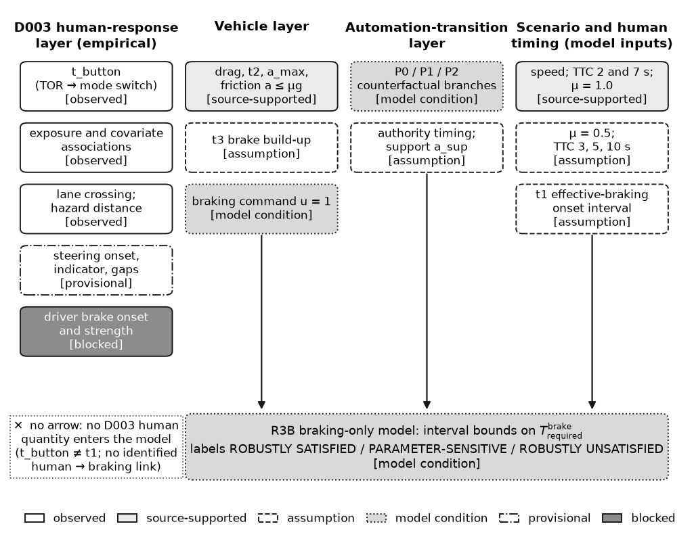
*Figure F1: Four-layer research framework separating vehicle response, human control reacquisition, transition policy, and scenario criticality, supported by an empirical observation layer and constrained by identifiability gates.*

---

## Main Findings (Grounded in Frozen Claim Ledger)

All findings reported below are strictly bounded by the frozen R5A Claim Ledger ([`research/R5A_CLAIM_LEDGER.csv`](research/R5A_CLAIM_LEDGER.csv)):

1. **Driver Mode-Switch Button Timing ($t_{\text{button}}$):**
   Across 492 anchorable D003 trials, mode-switch button actuation exhibits a median of **1.65 s** (IQR: 1.25–2.00 s; 5th–95th percentile: 0.95–2.90 s; Claim L03 notes button press is intent signaling, not hazard response time). Within participants, $t_{\text{button}}$ decreased modestly with repeated exposure (**$-0.033\text{ s}$ per exposure**, 95% CI $-0.058$ to $-0.007$; about $-0.26\text{ s}$ across 8 exposures; **associational only**; **Claim L01**).
2. **Inability to Identify Driver Braking in D003:**
   Longitudinal brake pedal telemetry in D003 is dominated by automated deceleration commands that straddle the mode switch (`Manual_Start`) and persist for up to $0.80\text{ s}$ into manual control (Claims L05, L06). Because the vehicle control state remains static (`state = 2.0`, Claim L07), independent human driver braking onset and pedal force cannot be identified from D003 telemetry (Claim L08).

   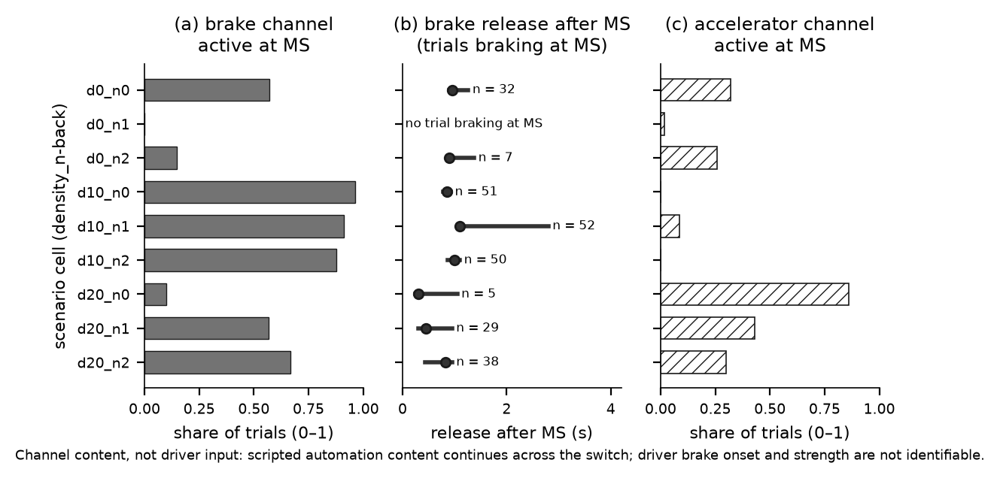
   *Figure F3: Empirical telemetry traces across Manual_Start in D003, showing scripted automated deceleration commands persisting into the manual driving phase (Claims L05, L06).*

3. **Deterministic Braking Recoverability (R3B Interval Slices):**
   Across the **150 canonical scenario–friction–policy evaluation cases** (25 speed/TTC scenarios $\times$ 2 friction levels $\times$ 3 transition policies):
   - **58 cases** are **ROBUSTLY SATISFIED** ($\min \Delta T \ge 0.01\text{ s}$ across the full parameter interval);
   - **47 cases** are **PARAMETER-SENSITIVE** ($\min \Delta T < 0 < \max \Delta T$, where recoverability depends strictly on where actual human/vehicle parameters fall within the assumed bounds);
   - **45 cases** are **ROBUSTLY UNSATISFIED** ($\max \Delta T \le -0.01\text{ s}$ across the full parameter interval; Claims L19, L20).

   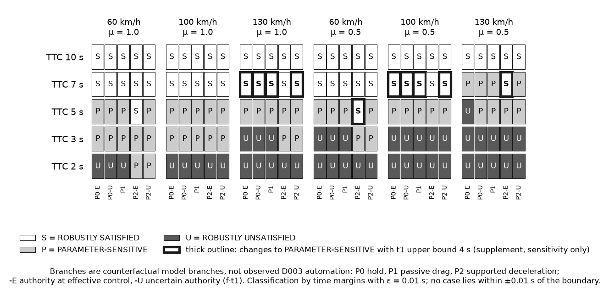
   *Figure F5: Braking-only recoverability classification across 150 scenario cases: 58 robustly satisfied, 47 parameter-sensitive, and 45 robustly unsatisfied (Claim L19). S/P/U labels and grayscale intensity distinguish the three within-model classifications; these are necessary-condition results, not safety labels.*

   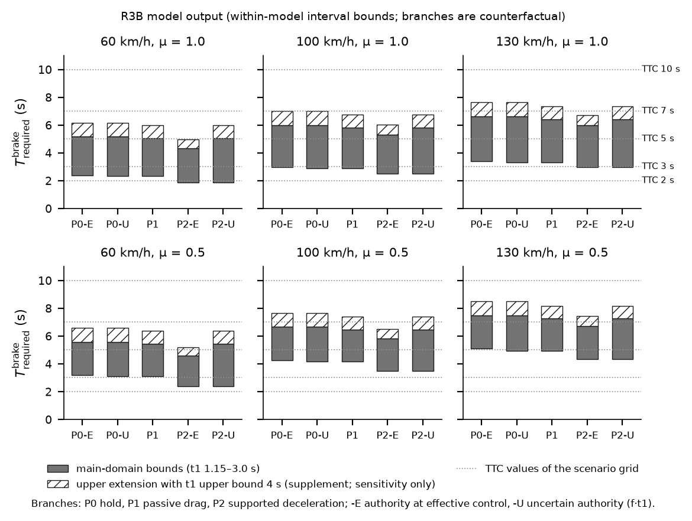
   *Figure F6: Deterministic interval bounds on required stopping time $T_{\text{req}}$ versus available TTC, showing parameter sensitivity dominated by assumed human braking latency $t_1$ (Claims L20, L24).*

4. **TTC is the Dominant Longitudinal Separator:**
   Within the deterministic braking model, initial TTC is the primary determinant of recoverability. High-TTC scenarios ($\ge 5.0\text{ s}$) are robustly satisfied at moderate highway speeds, whereas short-TTC emergency scenarios ($\le 2.5\text{ s}$) cannot be recovered by braking alone on low-friction surfaces ($\mu = 0.5$) under any policy (Claims L20, L25).
5. **Friction and Delay Sensitivity:**
   Pavement friction coefficient $\mu$ caps achievable deceleration at $\mu g$, acting as a hard physical constraint regardless of chassis braking hardware capability $a_{\max}$ (Claims L22, L23). The width of the required braking time interval $[T_{\text{req},\min}, T_{\text{req},\max}]$ is heavily dominated by the assumed human braking latency window $t_1 \in [1.15, 3.00]\text{ s}$ (Claims L24, L26).
6. **Steering Activity Timing vs. Assumed Braking Window:**
   In D003, empirical steering-angle activity onset occurs at a median of **3.85 s** post-TOR (IQR: 3.00–4.88 s; Claim L09). Measured from TOR, descriptive steering-angle activity onset in D003 **falls predominantly after the upper end of the R3B assumed braking-delay interval** ($[1.15, 3.00]\text{ s}$): $75.4\%$ of onsets fall after $3.00\text{ s}$ with the primary detector ($n = 491$), none before $1.15\text{ s}$, and a majority for every detector compared ($57$–$87\%$) and in every scenario cell ($51$–$98\%$; Claim L41).
   *Required qualifiers (Claim L41):* This observation is a cross-layer descriptive comparison between an empirical lateral signal event and an exogenous longitudinal modelling assumption. R3B $t_1$ is a model assumption, not an observed braking delay; steering authorship is unverified (Claim L11); the exact fraction depends on the detector definition (Claim L09); and the majority relationship does not hold against the $4.0\text{ s}$ supplementary bound ($47\%$ after $4.0\text{ s}$). No driver braking timing is implied.

   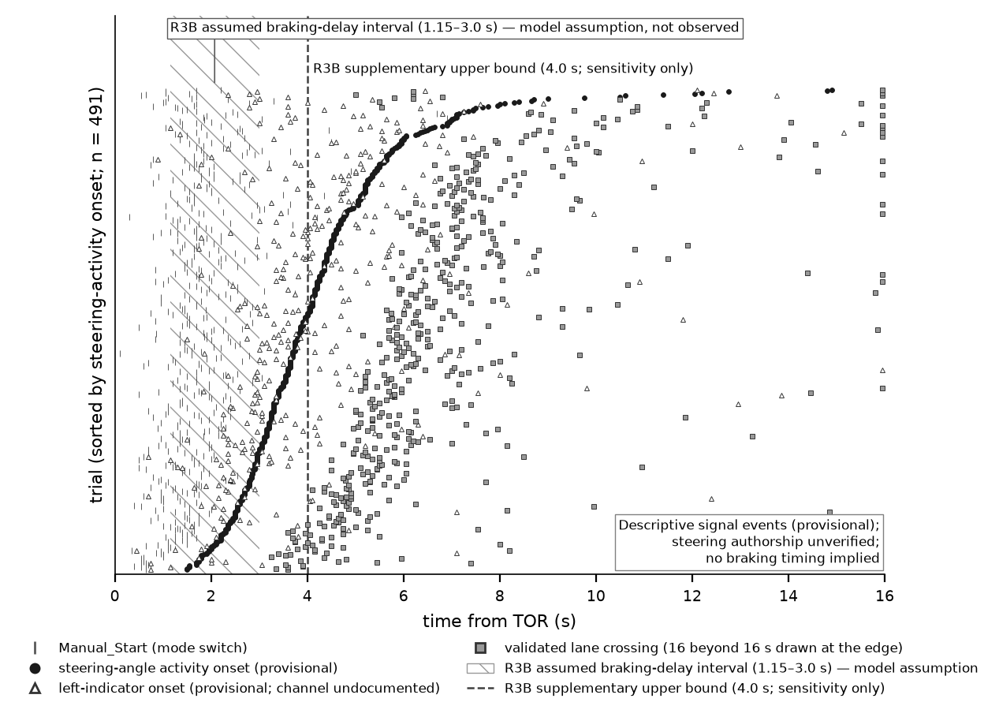
   *Figure F9: Empirical steering-angle activity onsets falling predominantly after the upper boundary of the assumed braking-delay window $[1.15, 3.00]\text{ s}$ (Claim L41; descriptive cross-layer comparison; no driver braking implied).*

7. **Combined Recoverability is Unidentifiable:**
   Because lateral hazard clearance margins, obstacle dimensions, and lane widths are missing from simulator logs, and independent driver braking is unobservable, joint longitudinal/lateral recoverability cannot be empirically validated without ungrounded synthetic assumptions (Claims L27, L29, L30).

---

## What the Project Does NOT Claim

To maintain strict scientific and assurance integrity, this project explicitly disclaims the following:

- **NO System-Level Safety Prediction:** The project does not predict real-world collision probabilities or claim that any vehicle or automation system is "safe" or "unsafe" (Claim L31).
- **NO Empirical Driver Braking Model:** No human braking reaction time distribution or brake pedal transfer function was fitted to D003, because driver braking inputs are confounded by automation script commands (Claims L05, L06).
- **NO Validated Combined (Braking + Steering) Envelope:** The project does not claim to have proven combined evasive trajectory recoverability. Longitudinal braking slices and descriptive lateral steering sequences are evaluated as separate, uncomposed evidence layers (Claim L30).
- **P0/P1/P2 are Counterfactual Model Branches:** The transition policies analyzed in Phase R3B are deterministic mathematical models representing hypothetical authority timing, not validated production controller software (Claims L24, L25).
- **R3B is a Necessary-Condition Analysis:** The deterministic braking model proves *necessary conditions* for stopping without collision; satisfying $T_{\text{req}} \le \text{TTC}$ does not guarantee safe operational recovery in complex traffic (Claims L19, L29).

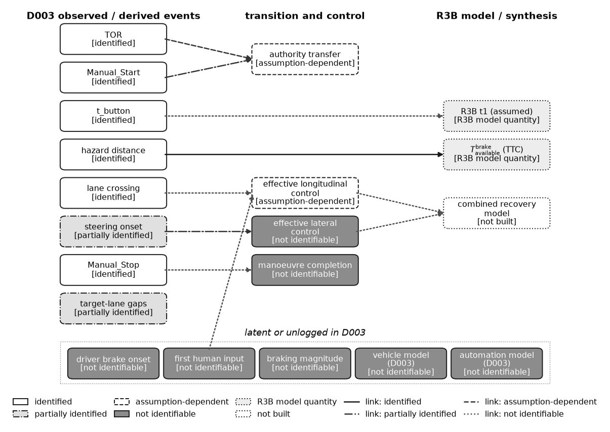
*Figure F10: Identifiability boundary distinguishing identifiable analytical and descriptive quantities from blocked composite recoverability claims across simulator and physical domains.*

---

## Repository Structure

```text
├── .github/workflows/        # Automated GitHub Actions CI for offline VLA reproducibility & provenance
│   └── vla_extension_verify.yml
├── docs/                     # Architectural baselines, decision records (D001-D038), audit logs
│   ├── DECISIONS.md          # Chronological record of all project decisions
│   ├── PROJECT_STATUS.md     # Phase ledger and milestone tracking
│   ├── PROVENANCE.md         # Curated public-release provenance verification notes
│   └── RESEARCH_ARCHITECTURE_V2.md # Four-layer closed-loop research framework
├── experiments/              # Legacy audit and analytical challenge documents (Phases A-H)
├── extensions/               # Research extensions preserving the frozen core baseline
│   └── vla_handover_feasibility/   # Audited AutoVLA trajectory & R3B handover feasibility pipeline
│       ├── artifacts/        # Evaluation summaries, claim register, command sensitivity, C10 robustness, HTML/PDF report & screenshots
│       ├── data/             # Scene manifest, SHA-256 camera digest, AutoVLA action codebook (agent_vocab.pkl)
│       ├── tests/            # 21 unit, synthetic-fixture, R3B-adapter, RQ1/RQ2 sensitivity, interactive explorer, demo, and provenance tests
│       ├── action_tokenizer.py     # Action token regex parser & SE(2) trajectory rollout decoder
│       ├── browser_qa.py           # Headless Chromium visual QA & screenshot generator
│       ├── c10_robustness.py       # RQ2 Scene 05 C10 numerical robustness audit (5 estimators x 5 windows x 3 thresholds)
│       ├── cloud_gpu_runner.py     # Optional cloud GPU execution wrapper
│       ├── command_sensitivity.py  # RQ1 controlled driving-command sensitivity runner & comparative evaluator
│       ├── demo.py                 # One-command offline evaluation & interactive dashboard launcher
│       ├── experiment_runner.py    # End-to-end evaluation & R3B counterfactual pipeline
│       ├── extract_navsim_scenes.py # On-demand OpenScene camera frame extractor & SHA-256 verifier
│       ├── interactive_explorer.py # Interactive R3B Simulator & Step-Aware AutoVLA Trajectory/Physics Explorer engine
│       ├── provenance_audit.py     # 11-point cryptographic & numerical provenance auditor
│       ├── r3b_adapter.py          # Adapter into unchanged src/vehicle and src/handover modules
│       ├── report_generator.py     # License-compliant English HTML/PDF dashboard & interactive demonstrator generator
│       ├── schemas.py              # Strongly typed dataclasses for scenes, trajectories, and R3B slices
│       ├── trajectory_verifier.py  # Independent C1-C10 physical feasibility verifier & synthetic fixtures
│       └── vla_inference.py        # Sequential batch_size=1 AutoVLA inference runner
├── research/                 # Foundational research registries, charters, and claim ledgers
│   ├── R5A_CLAIM_LEDGER.csv  # Authoritative 42-claim ledger (L01-L42, untouched)
│   ├── R3A_SOURCE_REGISTER.csv # External literature and standards evidence base
│   └── data_matrix/          # D003 field audits, EPA coastdown parameter derivations
├── results/                  # Committed analytical outputs, summary tables, and figures
│   ├── R1_ingestion_validation/   # D003 ingestion QA and owner reconciliation
│   ├── R2A_event_vehicle_descriptives/ # Channel activity diagnostics & populations
│   ├── R2B_repeated_exposure/     # Exposure slope models & participant trends
│   ├── R2C_lite/                  # Carry-over sensitivity models
│   ├── R3B_braking_bounds/        # Deterministic interval braking bounds & CSVs
│   ├── R4V_channel_authorship/    # Control channel authorship validation
│   └── R4V_steering_sequence/     # Steering sequence descriptives & hazard reconstruction
├── src/                      # Core project source code (Python package, untouched)
│   ├── data/                 # Strict D003 loader, population filters, QA pipelines
│   ├── driver/               # Parameterized driver response models
│   ├── experiments/          # Canonical experiment runners (R1, R2A, R2B, R2C, R3A, R3B, R4V)
│   ├── figures/              # R6A thesis figure rendering pipeline
│   ├── handover/             # Handover timeline models and policy definitions
│   ├── metrics/              # Control activity detectors, analytical derivatives, margins
│   ├── provenance/           # Structured metadata registries and report generators
│   └── vehicle/              # Physical vehicle models, road load, braking kinematics
├── tests/                    # Core automated pytest suite (public clone: 424 passed, 11 skipped, 1 deselected)
├── thesis/
│   └── figures/              # 12 canonical frozen publication figures (PNG and PDF)
│       └── figure_manifest.json # Cryptographic SHA256 hashes of all figure outputs
├── .gitignore                # Production artifact exclusions and third-party dataset protections
├── LICENSE                   # MIT License
├── pytest.ini                # Pytest configuration
├── README.md                 # Project overview and reproduction guide
└── requirements.txt          # Python package dependencies
```

---

## Installation

### Prerequisites
- Python 3.10 or higher (tested on Python 3.14.5)
- Standard virtual environment (`venv`)

### Setup Instructions
```bash
# 1. Clone the repository
git clone https://github.com/fengzhe-li/vehicle-aware-human-fallback.git
cd vehicle-aware-human-fallback

# 2. Create and activate a virtual environment
python3 -m venv .venv
source .venv/bin/activate

# 3. Upgrade pip and install dependencies
pip install --upgrade pip
pip install -r requirements.txt
```

---

## Running Tests & Offline Reproducibility

### 1. VLA Handover Feasibility Extension Suite & Offline Demo

The VLA extension is 100% reproducible offline from a fresh Git clone using only `requirements.txt` (without requiring `torch`, `transformers`, raw camera JPEGs, or the AutoVLA checkpoint):

```bash
# Run the one-command offline evaluation, provenance audit, and dashboard generator
python -m extensions.vla_handover_feasibility.demo --no-open

# Run the 21 extension unit, synthetic-fixture, R3B-adapter, RQ1/RQ2, interactive explorer, demo, and provenance tests
pytest extensions/vla_handover_feasibility/tests -v

# Or invoke the individual pipeline stages directly:
python -m extensions.vla_handover_feasibility.experiment_runner --skip-inference
python -m extensions.vla_handover_feasibility.command_sensitivity --skip-inference
python -m extensions.vla_handover_feasibility.c10_robustness
python -m extensions.vla_handover_feasibility.report_generator
python -m extensions.vla_handover_feasibility.provenance_audit
```

**Expected Extension Test Output:**
```text
================= 21 passed in ~1.8s =================
```

### 2. Core Baseline Test Suite

```bash
# Run the original baseline test suite
pytest tests/
```

**Expected Output on a Fresh Public Clone:**
- **Curated Public-Release Provenance Tests (`test_r2a`, `test_r2b`, `test_r2c_lite`):** Verify run-relevant dependency hashes via `tests/provenance_dependencies.py` (see [`docs/PROVENANCE.md`](docs/PROVENANCE.md)), with 11 tests skipped when optional external D003/EPA archives and the embargoed thesis draft are absent (`1` test deselected via `-m "not r3b_study"`).
- **Historical Audit Note ([`extensions/vla_handover_feasibility/artifacts/baseline_pytest_output.txt`](extensions/vla_handover_feasibility/artifacts/baseline_pytest_output.txt)):** Prior to the `tests/provenance_dependencies.py` content-hash adapter, running `pytest tests/` against squashed git history with local D003/EPA data on Python `3.14` recorded `430 passed, 1 skipped, 1 deselected, 4 failed` (`3` pre-release git commit SHA lookups in `test_r2a/r2b/r2c_lite` fixed on `main` via `provenance_dependencies.py`, and `1` byte-level PDF font stream metadata difference on `FA2_participant_exposure_slopes.pdf` under Python `3.14` Matplotlib while `test_scientific_results_unchanged` passes).

---

## Deterministic Figure Reproduction

All 12 thesis publication figures ([F1–F10, FA1–FA2](thesis/figures/)) can be deterministically rendered from stored analytical outputs:

```bash
# Render all figures into thesis/figures/
python3 -m src.figures.r6a_thesis_figures thesis/figures
```

Figure rendering is byte-deterministic on the reference build environment: outputs match the cryptographic hashes recorded in [`thesis/figures/figure_manifest.json`](thesis/figures/figure_manifest.json).

---

## External Data Availability & Licensing Compliance

Raw third-party datasets and multi-gigabyte model weights are **not redistributed** in this Git repository to respect third-party dataset licenses and repository size limits:

1. **TU Delft Conditionally Automated Takeover Dataset (D003):**
   - **Authors:** R. Happee et al. | **Repository:** 4TU.ResearchData | **DOI:** [`10.4121/uuid:e853b4e6-cba0-4e13-ac4b-506716ddd0fb`](https://doi.org/10.4121/uuid:e853b4e6-cba0-4e13-ac4b-506716ddd0fb) | **License:** CC BY 4.0
   - **Placement:** Download `tu_delft_takeover.zip` and place in `data/external/d003/`.
2. **EPA Test Car Certification Database:**
   - **Source:** US EPA (`24-testcar-2025-05.xlsx`) | **License:** Public Domain (US Government Work)
   - **Placement:** Place in `data/external/epa/`.
3. **OpenScene / NAVSIM Mini Sensor Blobs & AutoVLA Checkpoint (VLA Extension Live Inference Only):**
   - **Camera Images (`84 JPEGs`):** Derived from Motional nuPlan (`CC BY-NC-SA 4.0`) via `OpenDriveLab/OpenScene`. Raw `.jpg` files (`data/scenes/*/images/*.jpg`) are excluded from Git via `.gitignore` and replaced by cryptographic SHA-256 digests in [`extensions/vla_handover_feasibility/data/camera_images_sha256.json`](extensions/vla_handover_feasibility/data/camera_images_sha256.json). To materialize and verify the 84 camera frames on demand for live AutoVLA inference, run:
     ```bash
     python3 -m extensions.vla_handover_feasibility.extract_navsim_scenes
     ```
   - **AutoVLA Pretrained Checkpoint (`AutoVLA_PDMS_89.ckpt`):** Hosted on Hugging Face under [`Zewei-Zhou/AutoVLA`](https://huggingface.co/Zewei-Zhou/AutoVLA) (`ucla-mobility/AutoVLA`, MIT/Apache-2.0 compatible) and downloaded on demand when running live inference without `--skip-inference`.

---

## Reproducibility Scope

- **Committed Derived Results:** All derived CSV summaries, parameter tables, and statistical models in `results/`, as well as the cached AutoVLA action-token predictions (`extensions/vla_handover_feasibility/artifacts/predictions/*.json`), kinematic scene manifest (`scenes_manifest.json`), and SHA-256 camera manifest (`camera_images_sha256.json`), are committed directly to the repository. The verification test suites, thesis figure renderer (`r6a_thesis_figures.py`), and VLA evaluation/provenance pipeline execute offline immediately after cloning.
- **Raw Ingestion & Live Inference Pipelines:** If external source archives are downloaded as documented above, both the D003 ingestion pipeline (`src/data/d003_ingest.py`) and live AutoVLA inference (`extensions.vla_handover_feasibility.experiment_runner`) can be re-executed from scratch.
- **Provenance note:** Result records retain the historical development commit (`code_commit`) from which an analysis was produced. These identifiers refer to pre-release development history and are intentionally not part of the curated public-release Git history. For R2A, R2B and R2C, equivalence of the run-relevant dependencies is verified in this release by content hash. Details: [docs/PROVENANCE.md](docs/PROVENANCE.md).

---

## Licensing

- **Project Source Code & Architecture:** Licensed under the [MIT License](LICENSE).
- **Third-Party Data & Pretrained Weights:** External datasets (TU Delft D003, EPA test car data, Motional nuPlan / OpenScene) and external model weights (`ucla-mobility/AutoVLA`, `Zewei-Zhou/AutoVLA`, `Qwen/Qwen2.5-VL-3B-Instruct`) remain subject to their respective upstream licenses. No restricted raw camera imagery is redistributed in this repository.
- **Analytical Outputs:** Derived summary tables and metrics in `results/` and `extensions/vla_handover_feasibility/artifacts/` are provided for academic reproducibility under CC BY 4.0.

---

## Thesis Manuscript Notice

The full doctoral/master's thesis manuscript draft is **intentionally held from public release** pending institutional examination, defense, and degree award. This repository provides the complete open-source software, analytical data, and verification infrastructure supporting the dissertation.
