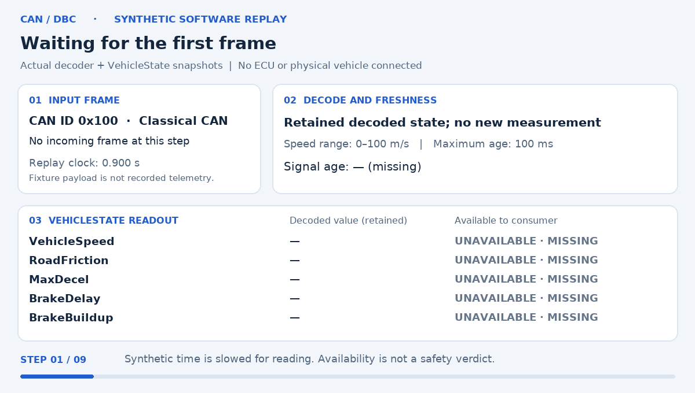

# Automotive CAN/DBC — synthetic replay demonstration

> **Review preview:** implementation is in [CAN PR #1](https://github.com/fengzhe-li/vehicle-aware-human-fallback/pull/1),
> currently unmerged. This main-based documentation/media branch carries the
> demonstration, not a released CAN implementation.

[Full-quality MP4, 18 seconds](../docs/media/engineering/can_decode.mp4) ·
[Static readout](../docs/media/engineering/can_decode_poster.png) ·
[Every computed snapshot](../docs/media/engineering/can_trace.json)

## What the animation actually does

The renderer imports the existing `Dbc`, `Frame` and `Replay` classes. It feeds
`synthetic_vehicle.dbc` the exact eight-byte payload from `replay_synthetic.py`:
`D0 07 64 50 64 32 00 00`, CAN ID `0x100`, timestamp `1.000 s`.

| Signal | Decoded synthetic value |
|---|---:|
| VehicleSpeed | 20.00 m/s (`2000 × 0.01`) |
| RoadFriction | 1.00 |
| MaxDecel | 8.00 m/s² |
| BrakeDelay | 0.10 s |
| BrakeBuildup | 0.50 s |

`Replay.snapshot()` supplies the state; `VehicleState.value()` with an explicit
100 ms age limit determines consumer availability. At age 100 ms, values remain
available. At 125 ms, they become unavailable. Their last decoded values remain
visible in a separate column, accurately reflecting the adapter's retained state.

The invalid-speed step applies the existing test's `FF FF` speed-byte pattern to
the example payload: raw 65535 decodes to 655.35 m/s, outside its DBC range
0–100 m/s. The speed read raises an error and is displayed as unavailable;
the other individually valid signals remain available. A subsequent original
fixture frame restores availability. These are deterministic software fault
cases, not recorded vehicle events.

Synthetic clock time is deliberately slowed for reading. Each of the nine
visual states maps to one row in `can_trace.json`; MP4 frames repeat those exact
readouts without interpolating telemetry. The footer explicitly distinguishes
signal availability from a safety verdict. No ECU, physical vehicle, HIL,
closed-loop controller or real-road safety test is represented.

## Reproduce and verify

See the [media generation and verification guide](../docs/ENGINEERING_MEDIA.md)
for the verified engineering checkout, commands, versions, hashes and merge order.
The [CAN implementation and build instructions](https://github.com/fengzhe-li/vehicle-aware-human-fallback/blob/ed96d22194536e0b3a72197682063052b7111341/docs/AUTOMOTIVE_CAN_DBC.md) remain on the
engineering PR until it is approved and merged. The original R3B equations and
research results are unchanged.
