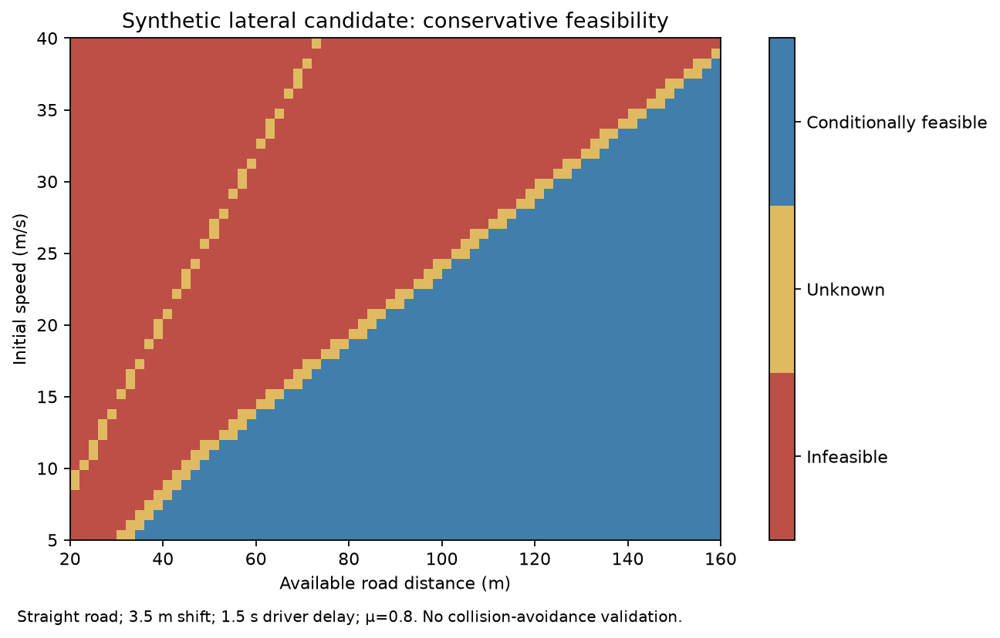
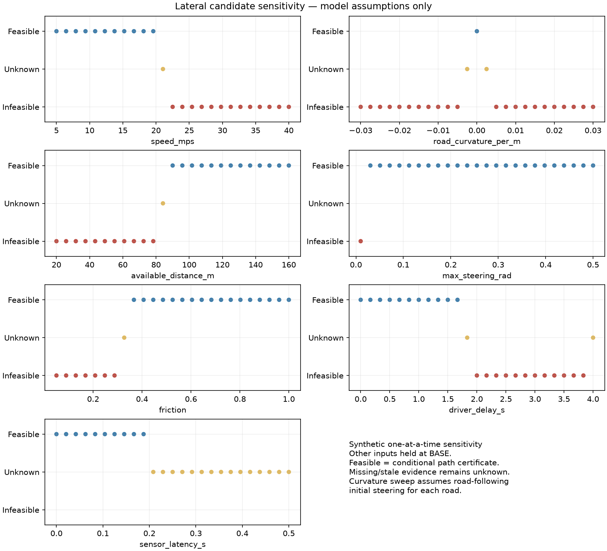
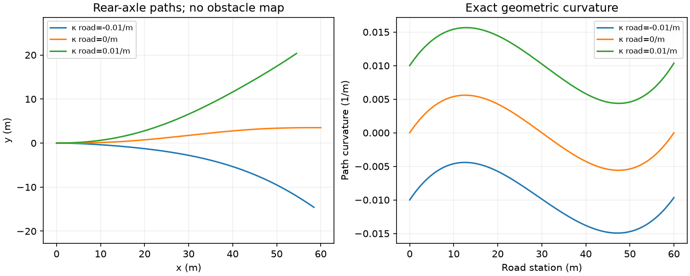

# Phase 2 validation record — 2026-11-10

## Actual local results

| Check | Result |
|---|---|
| New lateral unit/integration tests | **51 passed** |
| New lateral plus existing CAN Python tests | **55 passed** |
| Complete Python suite, including normally deselected R3B study | **479 passed, 1 failed, 11 skipped; no deselection** |
| Original complete R3B deterministic reproduction | **Passed**, output written only in pytest's temporary directory |
| Existing native CAN CTest | **1/1 passed** |
| Original scientific source/data/results/tests | **258 files byte-identical** to the pre-change baseline |
| Experiment repeatability | All **8 artifacts byte-identical**, including PNGs and summary, across two full runs |
| Hosted GitHub Actions | Not run |

Commands executed from the verified local repository:

~~~sh
MPLCONFIGDIR=/tmp/lateral-mpl-cache python3 -m pytest tests/test_lateral_recoverability.py tests/test_automotive_can.py -q
MPLCONFIGDIR=/tmp/lateral-mpl-cache python3 -m pytest -o addopts= -q
ctest --test-dir /tmp/vehicle-aware-can-build --output-on-failure
MPLCONFIGDIR=/tmp/lateral-mpl-cache python3 -m lateral_recoverability.experiments
MPLCONFIGDIR=/tmp/lateral-mpl-cache python3 -m lateral_recoverability.experiments --output /tmp/lateral-repeat
~~~

The final complete suite took 42.85 seconds. The existing R3B study marker was
explicitly included by clearing pytest's default addopts. Its reproduction test
passed despite the older marker description warning about previous gate changes.
The native library was unchanged; its existing built test executable was rerun.

The full-suite failure is the same pre-existing
tests/test_r2b.py::test_exposure_order_and_participant_counts failure reported
during the CAN task. With installed pandas 2.3.3, the existing comparison of a
Series of lists against a nested list raises a shape mismatch: (57,) versus
(57,9). An independent comparison after converting the grouped Series to a
Python list verified all 57 participants' exposure sequences are exactly 1..9.
The existing test and research data were preserved, without skipping or weakening
that assertion. The original skip conditions account for nine unavailable-D003
tests, one unavailable-EPA-workbook test, and one embargoed/local thesis-draft
module. These external inputs were not fabricated or replaced.

Machine-readable evidence and environment versions:
[validation.json](../lateral_recoverability/verification/validation.json).
The complete baseline file/hash list is
[research_baseline_sha256.json](../lateral_recoverability/verification/research_baseline_sha256.json).

## Test coverage

The 51 new cases cover:

- Quintic endpoint values, derivatives and analytical extrema.
- Straight paths and circular-road reference cases, including near-zero curvature.
- Cartesian finite-difference curvature and curvature-derivative checks for both
  road-curvature and shift directions.
- Dense independent checks that the analytical bounds enclose the whole sampled
  path across nine path lengths and three speeds. These checks supplement the
  analytical derivation; they do not replace it.
- Steering-angle units, wheelbase sensitivity, steering-rate limits, grip caps,
  exact-limit equality, usable-distance exhaustion and uncertainty crossing zero.
- Missing road geometry, missing clearance, unavailable corridors, incomplete
  displacement, uncertain/mismatched initial steering and stationary input.
- CAN/DBC decoding through the existing Replay class, km/h conversion,
  degree/radian conversion, calibrated steering ratios, signal freshness,
  missing/invalid/future data and redundant-sensor disagreement.
- Exact R3B parity, speed/friction bounds for fixed P0/passive/supported
  pre-control profiles, all nine combinations of candidate outcomes, and no
  collision-avoidance promotion.
- JSON configuration validation, nonfinite/extreme-scale handling, explicit
  unknowns for unsupported states and deterministic CSV reproduction.

## Synthetic experiments

The runner covers 3 speeds × 3 road curvatures × 3 distances × 3 steering limits
× 3 grip values × 3 driver delays × 3 sensor latencies × 4 evidence modes:
**8,748 cases**. All values are synthetic scenario choices. This grid is not an
empirical driving distribution, and outcome fractions are not probabilities.

| Candidate | Conditionally feasible | Infeasible under stated assumptions | Unknown |
|---|---:|---:|---:|
| Specified lateral path | 258 | 1,124 | 7,366 |
| Original R3B stopping candidate | 549 | 873 | 7,326 |

The combined layer reports 120 cases where both candidates are conditionally
feasible, 138 lateral-only certificates, 429 longitudinal-only certificates,
270 cases with neither evaluated candidate feasible, and 7,791 cases with
insufficient evidence or uncertainty. “Only” here identifies which candidate
has a certificate; it does not imply the other candidate is proven impossible.
No action is selected and no safer-manoeuvre comparison is made.

The large unknown count reflects intentional evidence gates. Missing steering,
sensor disagreement, stale data and uncertain initial steering are not
relabelled as feasible. Additional unknowns arise where analytical bounds
overlap a constraint or an uncertainty interval crosses zero remaining distance.

The 175-case one-at-a-time sensitivity study holds a recorded synthetic baseline
fixed while varying speed, curvature, distance, steering limit, grip, driver
delay and sensor latency. In these runs, increasing speed/delay or reducing
distance reduces the margin for the prescribed path; reduced grip can violate
the acceleration condition, and expired signals return unknown. Curvature
experiments re-establish ideal initial road following at each curvature and
withhold an R3B braking verdict on curved roads.

Artifacts:
[scenario table](../lateral_recoverability/artifacts/scenarios.csv),
[sensitivity table](../lateral_recoverability/artifacts/sensitivity.csv),
[input and hash manifest](../lateral_recoverability/artifacts/summary.json).

## Interpretation limits

Geometric corridor membership, simplified dynamic feasibility and validated
collision avoidance are separate concepts. The last remains not_validated in
all outputs. Clearance is an externally supplied vehicle-envelope assumption.
Steering transients, tyre dynamics, tracking performance, varying curvature,
moving traffic and simultaneous braking/steering are not validated here.
Initial steering uncertainty needs a future transient model; curved-road
braking needs a future joint grip model. No scientific claim in the original
research has been recalibrated or broadened by these synthetic results.
