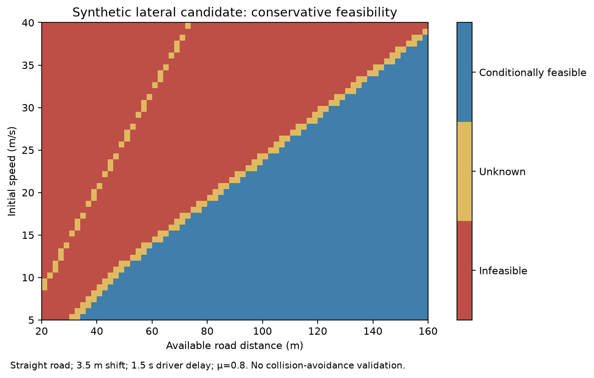
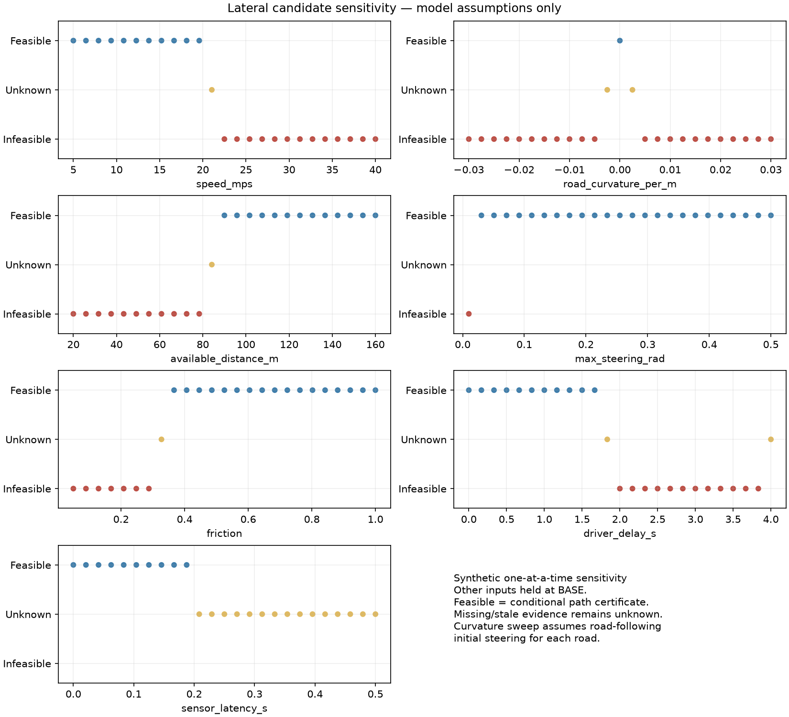
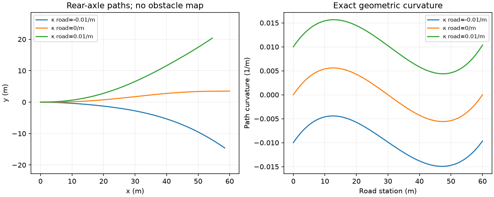

# Lateral recoverability: conditional candidate feasibility
> **Review preview:** [Lateral PR #2](https://github.com/fengzhe-li/vehicle-aware-human-fallback/pull/2)
> is still a draft stacked on CAN PR #1. This media branch does not contain its
> implementation. Code/documentation links below are pinned to the reviewed
> engineering commit; embedded figures are exact copies of that commit's outputs.

This extension evaluates a specified smooth lateral shift and the original R3B
longitudinal stopping candidate. Its outputs are **feasible**, **infeasible**, or
**unknown** under the supplied model conditions. Every result retains
collision_avoidance = not_validated. It never recommends steering, ranks steering
against braking, or certifies that no other manoeuvre could work.

## Engineering figures from the actual model run

These are byte-identical copies of the existing model artifacts, not newly drawn
illustrations. The [provenance manifest](../docs/media/engineering/manifest.json)
records their source commit and SHA-256 hashes. All cases are **synthetic and
conditional on the stated assumptions**. The original 8,748-case grid reports
258 conditionally feasible, 1,124 infeasible and 7,366 unknown outcomes; fractions
are not probabilities of successful driving.

### Feasibility changes with speed and available distance

This map is a separate straight-road diagnostic slice, not a plot of all 8,748
grid rows. It holds shift 3.5 m, driver delay 1.5 s and friction 0.8 fixed.
Unknown bands are retained wherever evidence or conservative bounds cannot
establish a verdict. Passing geometry alone does not certify dynamics or collision avoidance.

### Sensitivity to assumptions

The 175-case study varies one parameter at a time. The latency panel includes an
evidence-freshness cutoff; its unknown results must not be interpreted as
physical impossibility. Curvature cases re-establish ideal initial road following.

### Exact analytical candidate geometry

These curves are prescribed analytical candidates. They are not measured vehicle
tracks, controller trajectories, obstacle-clearance validation or a closed-loop
driving simulation. No animated vehicle or moving obstacle is added. Static
figures show the parameter dependence without implying path execution.

Reproduction and review details: [engineering media guide](../docs/ENGINEERING_MEDIA.md).

## Run

From the verified engineering checkout for PR #2, using its existing
requirements.txt dependencies (this media preview does not include the modules):

~~~sh
python3 -m pytest tests/test_lateral_recoverability.py tests/test_lateral_audit.py -q
python3 -m lateral_recoverability.audit
python3 -m lateral_recoverability.experiments --output lateral_recoverability/artifacts
~~~

The runner produces a deterministic 8,748-case synthetic sweep, a 175-case
one-at-a-time sensitivity analysis, three plots, sampled path geometry, a single
example result and a SHA-256 manifest. The --config option changes the single
example; the sweep uses the separately recorded AXES and BASE in experiments.py.
MPLCONFIGDIR=/tmp/lateral-mpl-cache can be set on systems with a read-only home.

~~~python
import json
from pathlib import Path
from lateral_recoverability.schema import load_config
from lateral_recoverability import assess_lateral
from lateral_recoverability.decision import BrakingAssumptions, assess_options

vehicle, scenario, state = load_config(json.loads(
    Path("lateral_recoverability/example.json").read_text()
))
lateral = assess_lateral(vehicle, scenario, state)
options = assess_options(vehicle, scenario, state, BrakingAssumptions(
    a_max_mps2=8.0, t_effective_s=1.5, t_authority_s=1.5,
    brake_delay_s=0.1, brake_buildup_s=0.5,
    source="Explicit synthetic braking assumptions; independent of steering onset",
))
print(lateral.outcome, options.assessment)
~~~

The experiment's single example deliberately omits braking assumptions and
therefore reports longitudinal unknown. Supply them explicitly through the API
to evaluate R3B. The sweep supplies and records synthetic braking assumptions,
including the choice of equal braking and steering driver delays.

## Input schema and conventions

See [example.json](https://github.com/fengzhe-li/vehicle-aware-human-fallback/blob/ed96d22194536e0b3a72197682063052b7111341/lateral_recoverability/example.json), [config.schema.json](https://github.com/fengzhe-li/vehicle-aware-human-fallback/blob/ed96d22194536e0b3a72197682063052b7111341/lateral_recoverability/config.schema.json), and the
validated dataclasses in [schema.py](https://github.com/fengzhe-li/vehicle-aware-human-fallback/blob/ed96d22194536e0b3a72197682063052b7111341/lateral_recoverability/schema.py). Unknown keys are rejected.
Units are SI, front steering means **road-wheel angle**, positive road curvature
turns left, and positive lateral offset is left of the reference road. Position
and speed refer to the bicycle rear axle. These conventions require an explicit
mapping for any real sensor platform.

| Input | Unit / meaning |
|---|---|
| speed_mps | Closed nonnegative interval; constant path speed during the candidate |
| front_steering_rad | Closed front road-wheel angle interval; no inferred steering ratio |
| latency_s | Closed interval, at least the oldest observation age |
| wheelbase_m | Rear-to-front axle spacing; positive |
| max_steering_rad, max_steering_rate_rad_s | Road-wheel angle and rate constraints |
| max_lateral_accel_mps2 | Assumed lateral acceleration constraint |
| road_curvature_per_m | Constant reference-road curvature, or null for unavailable geometry |
| available_distance_m | Along-road station to a stationary hazard, at the observation epoch |
| target_offset_m | Signed final displacement relative to the road |
| driver_delay_s | Time until effective steering response after observation latency |
| steering_delay_s | Additional actuator dead time before the path begins |
| friction | Closed tyre-grip coefficient interval, or null for unavailable grip |
| clearance | External corridor, hazard clearance, and longitudinal buffer assumptions |

Intervals express bounded uncertainty, not distributions or confidence levels.
Missing road/grip/clearance uses null; missing measurements use an evidence state
and null bounds. No missing value is replaced by a nominal estimate.

The clearance corridor is a **vehicle-reference-point admissible band already
eroded for the whole vehicle footprint, orientation, tracking errors and chosen
road/obstacle margins**. Its availability must cover the delay, manoeuvre and
terminal continuation. The selected side must satisfy the declared required
offset and the scenario must establish that this side clears the obstacle. This
module checks centre-path membership in that supplied band; it does not infer
the band from lane width, CAN data, images or an obstacle map.

## Evidence and CAN integration

[can_adapter.py](https://github.com/fengzhe-li/vehicle-aware-human-fallback/blob/ed96d22194536e0b3a72197682063052b7111341/lateral_recoverability/can_adapter.py) consumes the existing Python
automotive_can.dbc.VehicleState. It reads signal validity and per-signal
timestamps, converts declared m/s or km/h and rad or degrees, and requires a
calibrated ratio for a steering-wheel signal. Its error arguments are absolute
SI bounds. No native Python binding is implied; the prior C++ library is
unchanged.

~~~python
from lateral_recoverability.can_adapter import Bindings, from_can

# vehicle_state is returned by the existing CAN/DBC decoder.
state = from_can(
    vehicle_state, now_ns=clock_ns, max_age_ns=250_000_000,
    bindings=Bindings(steering_signal="FrontWheelSteering"),
    speed_error_mps=0.5, steering_error_rad=0.01,
)
~~~

This nonzero steering uncertainty will produce an explicit lateral unknown:
the path assumes exact initial road following, and the module does not have a
transient controller that could certify recovery from uncertain initial
steering. Missing, stale, invalid and future-dated signals are also explicit
evidence states. A supplied redundant sensor must be usable; disjoint intervals
yield sensor_disagreement. Overlapping measurements use their conservative
hull. No statistical independence is assumed.

Road geometry, footprint clearance, tyre grip, steering calibration, heading
alignment and human response timing are external assumptions. The original CAN
fixture has no front steering signal; its absence correctly yields unknown.
The API checks each relevant signal rather than trusting the older adapter's
aggregate validity flag.

## Outputs

LateralResult reports separate geometry and dynamics outcomes, reasons, bounded
demands, delay and usable-distance bounds, and complete input evidence. Decision
preserves both candidate assessments and their assumptions. It includes
neither_evaluated_candidate_feasible_under_assumptions only when both candidates
are infeasible; a missing or uncertain candidate remains visible.

| Artifact | Contents |
|---|---|
| scenarios.csv | Synthetic-only flag, eight swept inputs; lateral, geometric, dynamic and longitudinal outcomes; evidence states and reasons |
| sensitivity.csv | Parameter/value and complete scenario row for each of 175 one-at-a-time cases |
| path_samples.csv | Cartesian position, road station, offset, heading, curvature, curvature derivative and path metric |
| example_result.json | Structured decision with assumptions and uncertainty bounds |
| summary.json | Counts, axes, constants, example configuration, software versions and source/artifact hashes |
| feasibility_map.png | Conditional lateral outcomes versus speed and available distance |
| sensitivity.png | Conditional outcomes across seven varied parameters |
| path_geometry.png | Exact geometry on three constant-curvature reference roads |

The plotted and sampled paths illustrate the model. Feasibility certification
uses analytical bounds rather than a sampled maximum.

## Research boundary

The approximation is a planar no-slip kinematic bicycle with constant speed,
constant road curvature, ideal initial road following and a prescribed quintic
offset path. It tests steering angle/rate and the necessary grip condition
v² |curvature| <= min(lateral_limit, mu*g). It does not model tyre slip,
understeer, yaw transients, load transfer, bank/grade, ESC, actuator tracking,
steering acceleration, moving traffic, road-edge perception or path execution.
Passing those simplified constraints is not validation at high speed or near
grip saturation.

R3B equations and historical classifications remain unchanged. The additive
stopping adapter supports fixed explicit R3B timelines and pre-control profiles
with speed/friction intervals. On curved or unknown roads it returns longitudinal
unknown because a shared lateral/longitudinal tyre-force model is absent.
Unusable or nonzero/uncertain initial steering also withholds a stopping verdict.
`assess_combined_braking_steering()` explicitly returns unknown because no coupled
trajectory and tyre-force model is implemented.
Braking and steering are alternative candidates, never a simultaneous
brake-and-steer policy.

See [model derivation and assumptions](https://github.com/fengzhe-li/vehicle-aware-human-fallback/blob/ed96d22194536e0b3a72197682063052b7111341/docs/LATERAL_RECOVERABILITY.md) and
[actual validation results](https://github.com/fengzhe-li/vehicle-aware-human-fallback/blob/ed96d22194536e0b3a72197682063052b7111341/docs/LATERAL_VALIDATION.md). No real vehicle, ECU,
HIL, high-fidelity dynamics, real-road or functional-safety validation is claimed.

## Acceptance audit

The [validation report](https://github.com/fengzhe-li/vehicle-aware-human-fallback/blob/ed96d22194536e0b3a72197682063052b7111341/docs/LATERAL_VALIDATION.md) records the historical and
revised counts, primary and overlapping unknown causes, exact artifact comparisons,
protected-file exception and actual Git delivery. `python3 -m lateral_recoverability.audit`
writes `verification/audit/unknown_analysis.json` and `case_reasons.csv`; it includes
complete representative inputs and supplementary cases outside the sweep denominator.
